import { Aside } from '@astrojs/starlight/components';

`kurac` lowers source through several phases, each with a representation suited to the work
done on it.

```mermaid
---
config:
  layout: dagre
---
graph LR
    subgraph Frontend [Frontend Phase]
      Parser[Lexer & Parser]
      ParseTree[Parse Tree]
      AST[Expr AST]
    end

    subgraph Backend [Middle-End & Analysis Phase]
      SSAGraph[Flow Graph<br/>SSA, per function]
      Analysis[Analysis Passes]
      TypedGraph[Typed Flow Graph]
    end

    subgraph Lowering [Lowering & Codegen Phase]
      GIR[GIR<br/>Graphics IR]
      LLVM[LLVM IR]
    end

    subgraph Targets [Output Targets]
      JIT[JIT Execution<br/>--run]
      ObjFile[Object File<br/>--emit-obj]
      CHeader[C Header<br/>--emit-header]
    end

    Parser --> ParseTree --> AST
    AST --> SSAGraph

    SSAGraph --> Analysis
    Analysis --> TypedGraph

    TypedGraph -->| default |LLVM
    TypedGraph -->|view| GIR
    GIR --> LLVM

    %% Output Emissions
    LLVM --> JIT
    LLVM --> ObjFile
    LLVM --> CHeader

    %% Styling
    style TypedGraph fill:#2e303f,stroke:#7c8f9f,stroke-width:1px;
    style JIT fill:#1d2b24,stroke:#3b694c;
    style ObjFile fill:#1d2b24,stroke:#3b694c;
    style CHeader fill:#1d2b24,stroke:#3b694c;
```

<Aside type="caution">
The compiler is changing quickly. Stage names here follow the source tree; individual
representations (especially around UI and layout) are still being reworked.
</Aside>

## Frontend

The lexer and parser are generated by ANTLR4 from `KuraLexer.g4` and `KuraParser.g4`. The
parse tree is converted into the `Expr` tree by `frontend/expr_builder`. `Expr` nodes cover
every v1 construct: lambdas, `fold`, variants, unit literals, and type declarations.

<Aside type="note">
ANTLR is planned to be replaced once the v1 syntax settles, so the compiler can track source
spans more precisely. That also benefits tooling: the planned language server will reuse the
frontend and needs spans on every node.
</Aside>

## Flow graph

Each function becomes a flow graph in SSA form, in the style of Dart's Kernel IR and LLVM's
own. Instructions include constants, unary and binary operations, record and sequence
construction, property loads and stores, calls, branches and phis (see
`backend/flow_graph.h` and `backend/ir.h`).

Analyses run on the flow graph rather than on a separate typed AST:

- **Type analysis** (`type_analysis.cc`) resolves types, including width-specific numeric types
  and implicit conversions.
- **Purity analysis** (`purity_analysis.cc`) determines which functions are pure. `view` must be
  pure.

## `view` and GIR

`view` isn't compiled into an object constructor. It lowers into the **GIR** (graphics
intermediate representation, `backend/gir.h`): specialized instructions that match the
[renderer ABI](/kura/developers/renderer-abi/), such as `BeginFrame`, `EndFrame`,
fill and draw rect, text drawing, clip push and pop, and text measurement.

While compiling `view`, the compiler builds a compile-time virtual DOM that it optimizes and
lowers into GIR. The goal is to eliminate the UI tree as early as possible and keep it out of
the runtime.

## Layout and reactivity

Each node gets an id from a numbering pass (like basic-block numbering), and geometry is
stored in vectors indexed by that id. `update` ends with an epilogue that checks a dirty flag
and, when geometry might have changed, calls a generated stub that reflows the UI.

## Backend

`llvm_codegen` emits LLVM IR calling into the runtime ABI (`runtime_abi.h`, the
`kura_rt_*` functions). From there `kurac` can:

- run the module with the JIT (`--run`)
- write a native object file (`--emit-obj`)
- write a C header for exported functions (`--emit-header`)

C headers are imported with clang (`c_import`), and `c_compile` builds the small wrapper
functions needed for struct passing and `static inline` functions.

## Diagnostics

Error messages are a design goal: clear, specific, and with numeric error codes. The style is a
mix of rustc and Elm, with `--explain` for longer descriptions. Release builds strip the error
context and tracking data. Debug info for release builds is a separate build artifact.

## Testing

Testing and debugging are part of the toolchain: a headless renderer for unit tests, an image
renderer for visual regression, and a basic visual debugger. Parser fuzzing and automated
testing of every component run in CI.
